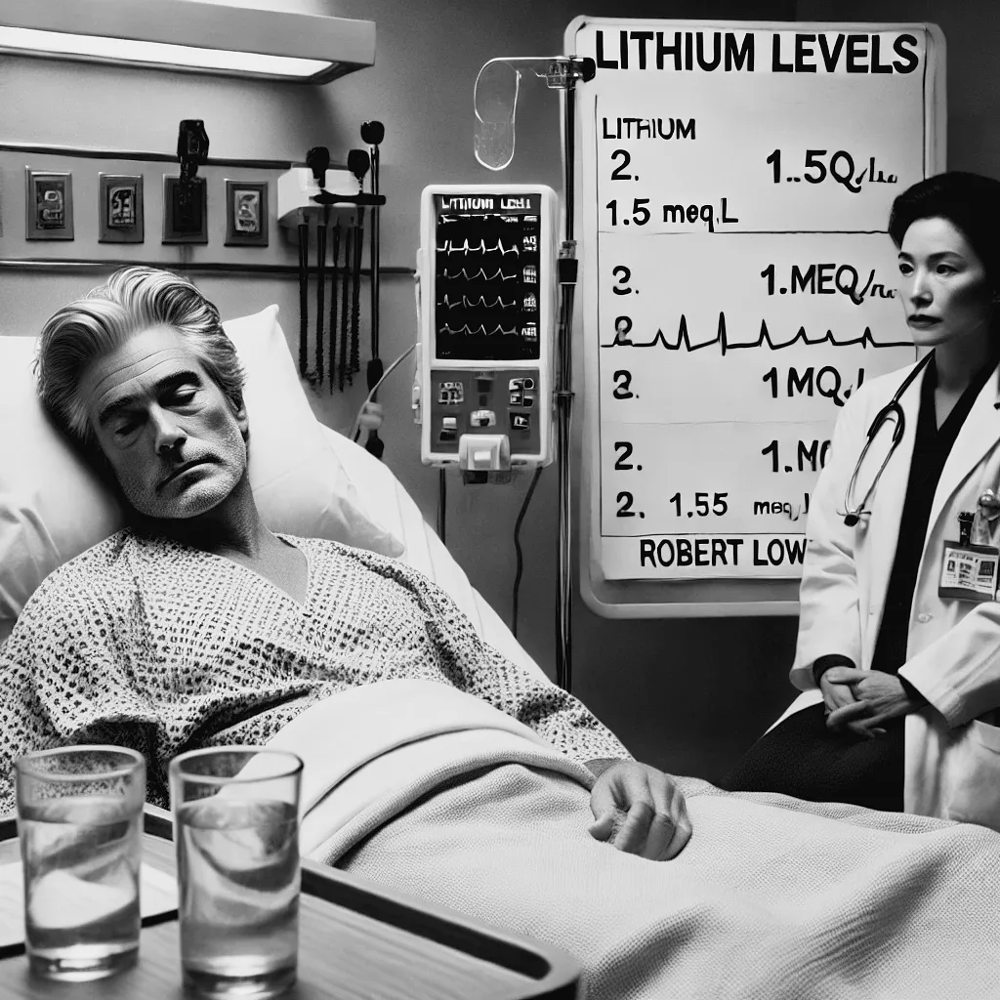

<figure class="ilustracao">

<figcaption>Created by DALL·E  - Robert Lowell, looking drowsy due to lithium intoxication, lies in a hospital bed. Ilustração gerada por IA (DALL·E)</figcaption>

</figure>

Desde que começou usar o lítio, Lowell foi internado passou apenas por uma breve internação em 1970. Mas depois de 1975, até sua morte em 1977, as crises de Lowell voltaram a atormentar sua vida. Em maio de 1975 Lowell teve de ser internado devido a uma intoxicação por lítio. Ele tinha aumentado sua dose de 5 para 8 comprimidos por dia. Seu nível sérico de lítio subiu para 1.5 mEq/L. Lowell foi internado num quadro de delirium e sua dose de lítio foi reduzida abruptamente. (<a class="cite" href="/robert-lowell/capitulos/referencias/#ref-Jamison2017" data-ref="Jamison2017" title="Jamison, Kay Redfield (2017). Robert Lowell: setting the river on fire, a study of genius, mania, and character">Jamison, 2017, p. 183</a>) Daí em diante suas oscilações pioraram e passou por várias internações nos anos de 1975 e 1976. Em fevereiro de 1976, um ano e meio antes de morrer, Lowell escreveu estar “sobrecarregado com a nova frequência de ataques”, e sentia-se incapaz de funcionar “com dois ataques maníacos em um ano” (<a class="cite" href="/robert-lowell/capitulos/referencias/#ref-Jamison2017" data-ref="Jamison2017" title="Jamison, Kay Redfield (2017). Robert Lowell: setting the river on fire, a study of genius, mania, and character">Jamison, 2017, p. 176</a>)

Lowell faleceu em 12 de setembro de 1977, em Nova Iorque, aos 60 anos de idade.
