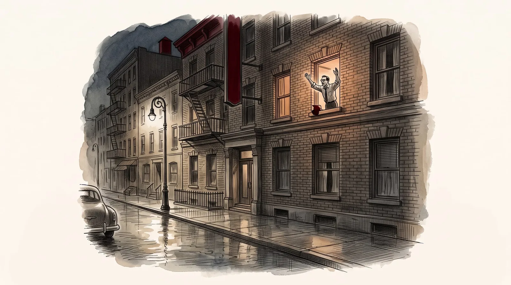

<figure class="ilustracao">

<figcaption>Image created by DALL·E A realistic sketch of the poet Robert Lowell shouting from the window of his hotel room. Ilustração gerada por IA (DALL·E)</figcaption>

</figure>
Em outubro de 1948 Lowell se mudou para uma colônia de escritores em Saratoga Springs, para escrever seu poema "*The Mills of Kavanaughs*". Seu primeiro surto de mania começou lentamente no final de desse ano. Lowell começou a abusar de álcool, sua mente começou a se acelerar, sua produção literária aumentou até se desorganizar (<a class="cite" href="/robert-lowell/capitulos/referencias/#ref-Jamison2017" data-ref="Jamison2017" title="Jamison, Kay Redfield (2017). Robert Lowell: setting the river on fire, a study of genius, mania, and character">Jamison, 2017, pp. 98-99</a>). Em fevereiro de 1949 começou a se preocupar obsessivamente com a influência de comunistas em sua região, evoluindo para um quadro de excitação, exaltação do humor e delírios de cunho místico-religioso. Em seu delírio, Lowell acreditava estar numa missão de purificação e de canonização e que Deus falava através dele. Nessa fase de exaltação e fervor religioso chegou a ficar recluso em um monastério Trapista por cerca de uma semana (<a class="cite" href="/robert-lowell/capitulos/referencias/#ref-Jamison2017" data-ref="Jamison2017" title="Jamison, Kay Redfield (2017). Robert Lowell: setting the river on fire, a study of genius, mania, and character">Jamison, 2017, p. 99</a>). A partir daí o quadro se agravou e Lowell entrou num estado fora de controle, evoluindo para um quadro delirante de grandiosidade, de cunho místico e persecutório (<a class="cite" href="/robert-lowell/capitulos/referencias/#ref-Jamison2017" data-ref="Jamison2017" title="Jamison, Kay Redfield (2017). Robert Lowell: setting the river on fire, a study of genius, mania, and character">Jamison, 2017, p. 99</a>). Viajou para Chicago e contou a uma amiga que tinha descoberto o segredo do universo, causou problemas num restaurante e, da janela do quarto de seu hotel, começou a gritar obscenidades. Passou a acreditar que estava sendo perseguido por "forças do mal". Voltando para Bloomington, correu pelas ruas da cidade gritando contra demônios e chegou a pensar que era a reencarnação do Espírito Santo. Na Faculdade de Indiana criou um caos ao dizer que o demônio estava escondido em um dos vasos de plantas. Foi em seguida levado pela polícia para cadeia, onde passou uma noite, tendo sido levado para uma clínica psiquiátrica no dia seguinte (<a class="cite" href="/robert-lowell/capitulos/referencias/#ref-Jamison2017" data-ref="Jamison2017" title="Jamison, Kay Redfield (2017). Robert Lowell: setting the river on fire, a study of genius, mania, and character">Jamison, 2017, p. 102</a>). Essa seria sua primeira internação, aos 32 anos de idade.

Lowell deu entrada no Balpate Hospital no dia 06 de abril de 1949. Foram cerca de aproximadamente 4 meses de evolução de sua crise, que começou no final de 1948. Lowell, nessa primeira internação, foi descrito como eufórico, excitado, hiperativo, exaltado, e falando sem cessar. Ele disse aos médicos que era indestrutível, que era um mensageiro dos Céus, que havia sido Cristo há pouco tempo, que havia andado sob as águas, que se comunicava regularmente com Deus, que era a reencarnação do Espírito Santo e que havia derrotado as forças do mal. Contou também que tinha tido visões de seres verdes que o assustavam e que não estava dormindo há dias. Em resumo, estava num estado de mania (<a class="cite" href="/robert-lowell/capitulos/referencias/#ref-Jamison2017" data-ref="Jamison2017" title="Jamison, Kay Redfield (2017). Robert Lowell: setting the river on fire, a study of genius, mania, and character">Jamison, 2017, p. 103</a>).

Sua noiva, Elizabeth Hardwick, contou que os meses que antecederam a internação foram assustadores. Muitos de seus amigos só compreenderam que Lowell estava realmente doente quando ele foi internado. Em junho de 1949, ainda no hospital, Lowell foi tratado com seis sessões de eletroconvulsoterapia (ECT), o único tratamento disponível na época para a mania. Seus delírios e sua agitação melhoraram quase que imediatamente. Entretanto, uma semana depois Lowell entrou num estado depressivo grave. Sentia-se incapaz de escrever, de concentrar, seu pensamento estava lentificado, sentia-se sem energia. Preferia ficar sozinho e teve pensamentos suicidas (<a class="cite" href="/robert-lowell/capitulos/referencias/#ref-Jamison2017" data-ref="Jamison2017" title="Jamison, Kay Redfield (2017). Robert Lowell: setting the river on fire, a study of genius, mania, and character">Jamison, 2017, pp. 104-105</a>). Lowell recebeu alta no dia 12 de julho de 1949, depois de mais de 3 meses de internação (<a class="cite" href="/robert-lowell/capitulos/referencias/#ref-Jamison2017" data-ref="Jamison2017" title="Jamison, Kay Redfield (2017). Robert Lowell: setting the river on fire, a study of genius, mania, and character">Jamison, 2017, p. 112</a>).

Ao sair de hospital estava ainda depressivo, se sentindo humilhado por tudo que havia feito durante sua crise de mania. Sentia-se consumido pela culpa e remorso por todo sofrimento que havia causado. Entretanto, apesar dessa depressão, duas semanas depois ele e Elizabeth Hardwick se casaram. Esses primeiros meses de casamento foram marcados pela fase depressiva de Lowell, com sentimentos de abandono, autoacusação e desesperança (<a class="cite" href="/robert-lowell/capitulos/referencias/#ref-Jamison2017" data-ref="Jamison2017" title="Jamison, Kay Redfield (2017). Robert Lowell: setting the river on fire, a study of genius, mania, and character">Jamison, 2017, p. 108</a>). Aos poucos depressão de Lowell se agravou, passava dias deitado na cama, sozinho, voltou a ter alucinações, delírios e pensamentos suicidas.
