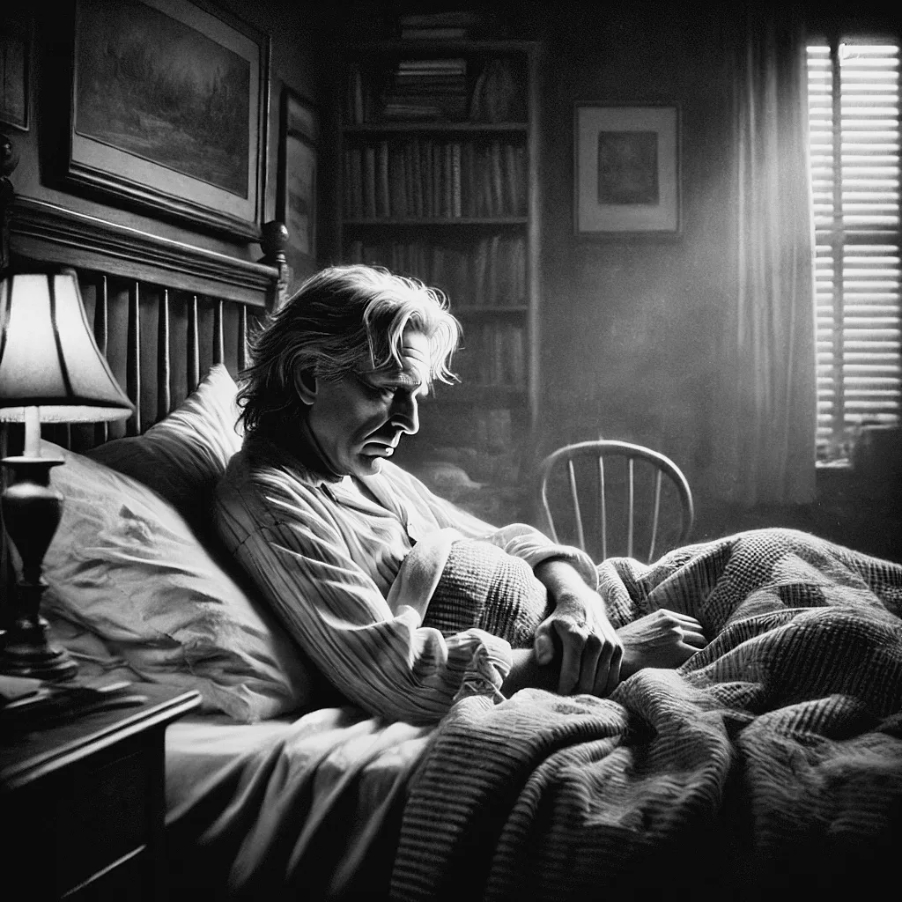

<figure class="ilustracao">

<figcaption>Image create by DALL·E - A realistic sketch of the poet Robert Lowell lying down in a bed, depicted in a very low mood. Ilustração gerada por IA (DALL·E)</figcaption>

</figure>

No dia 13 de setembro de 1949, foi novamente internado numa clínica psiquiátrica (<a class="cite" href="/robert-lowell/capitulos/referencias/#ref-Jamison2017" data-ref="Jamison2017" title="Jamison, Kay Redfield (2017). Robert Lowell: setting the river on fire, a study of genius, mania, and character">Jamison, 2017, pp. 108-109, 112</a>). Essa foi sua segunda internação, dessa vez num estado depressivo grave. Estava lentificado, com dificuldade para se concentrar, com humor deprimido. Sentia-se vazio, sem coragem, passava dias sem conversar. Nessa internação passou vários dias deitado na cama pensando em suicídio. Como não havia ainda antidepressivos, durante os quase quatro meses dessa internação seu tratamento consistiu em psicoterapia (<a class="cite" href="/robert-lowell/capitulos/referencias/#ref-Jamison2017" data-ref="Jamison2017" title="Jamison, Kay Redfield (2017). Robert Lowell: setting the river on fire, a study of genius, mania, and character">Jamison, 2017, p. 110</a>). Lowell recebeu alta no início de janeiro de 1950. Havia perdido quase um ano para a doença, que ainda traria muito sofrimento nas próximas décadas de sua vida.
