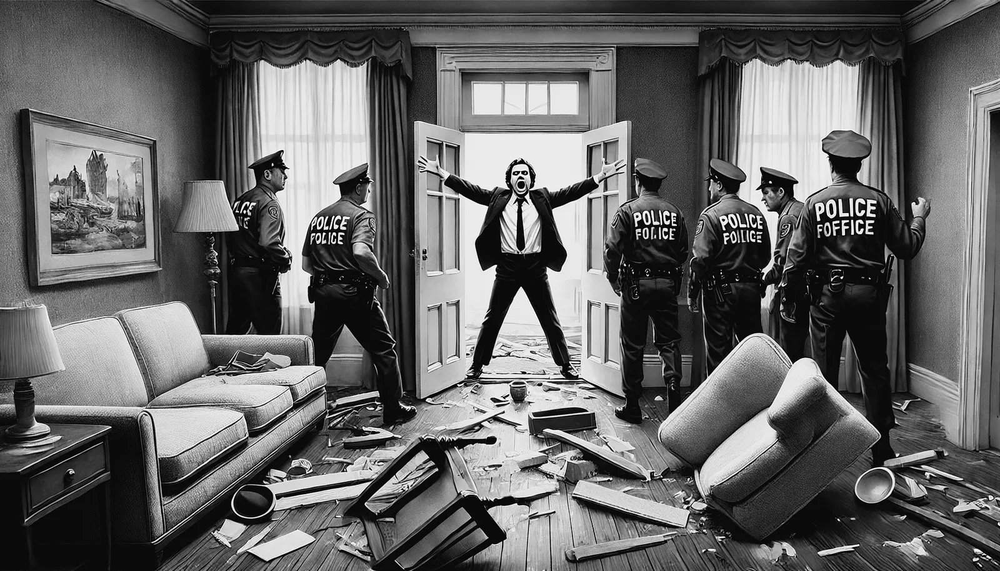

<figure class="ilustracao">

<figcaption>Corredor de hotel; porta entreaberta com uma cadeira e um baú encostados por dentro; duas pessoas preocupadas no corredor. Ilustração gerada por IA (Google Gemini)</figcaption>

</figure>

No verão de 1952 Lowell e Hardwick viajaram para Salzburg, na Áustria, para uma conferência na qual ele seria um dos palestrantes. Lowell estava eufórico com essa viagem e, diferentemente da primeira crise, evoluiu muito rapidamente para um estado de mania. Tornou-se irritadiço e impulsivo, se apaixonou por uma estudante de música. Certo dia desapareceu do castelo onde estava acontecendo a conferência e foi encontrado vagando na fronteira da Áustria com a Alemanha. Estava falando sem parar por toda noite. O dia de sua internação foi um verdadeiro caos no castelo, com carros de polícia por todo lado. Lowell estava em seu quarto, com uma aparência selvagem, "carregado de adrenalina". Tinha feito uma barricada em seu quarto e se recusava a sair. Foi levado para internação de forma involuntária, num estado de mania, furioso, falando rápido e de forma incoerente (<a class="cite" href="/robert-lowell/capitulos/referencias/#ref-Jamison2017" data-ref="Jamison2017" title="Jamison, Kay Redfield (2017). Robert Lowell: setting the river on fire, a study of genius, mania, and character">Jamison, 2017, pp. 113-115</a>). Foi levado inicialmente para o American Army Hospital em Salzburg e depois transferido para o U.S. Army Hospital em Munique, onde foi tratado com seis ou sete sessões de ECT, e depois para o Sanatório Binswanger, na Suíça. Sua internação foi bem mais rápida que a primeira, tendo durado de agosto a meados de setembro. Depois dessa internação Lowell escreveu que "num período de vinte dias passei pelos três estágios da exuberância, confusão e depressão e posso dizer agora que está tudo terminado, sem nenhum sinal de recaída". Lowell minimizava a gravidade de sua crise e tinha um otimismo exagerado com o futuro de sua doença. Sua próxima crise, entretanto, viria mais cedo que ele esperava.
