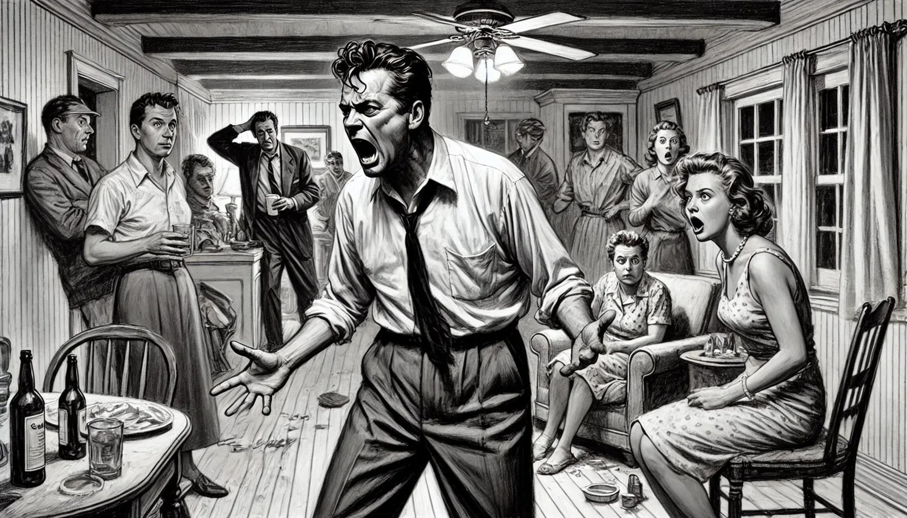

<figure class="ilustracao">

<figcaption>Image created by DALL·E - A realistic sketch in grayscale of a chaotic party at Robert Lowell's house. Robert Lowell is prominently featured, visibly intoxicated and shoutingangrily Ilustração gerada por IA (DALL·E)</figcaption>

</figure>
O ano de 1957 foi marcante na vida de Lowell. Ao longo desse ano sua energia e entusiasmos foram aumentando gradativamente até culminar numa crise grave de mania no final do ano. Durante vários meses estava dormindo menos, bebendo mais e usando clorpromazina para se acalmar. Durante os meses de Setembro a Outubro de 1957 Lowell foi extremamente produtivo em sua escrita,  tendo escrito vários dos poemas de "Life Studies" (<a class="cite" href="/robert-lowell/capitulos/referencias/#ref-Jamison2017" data-ref="Jamison2017" title="Jamison, Kay Redfield (2017). Robert Lowell: setting the river on fire, a study of genius, mania, and character">Jamison, 2017, pp. 135-136, 299</a>). Lowell, quando nesses períodos de hipomania, sentia que a poesia era mais original, mais radical e "vinha mais facilmente" (<a class="cite" href="/robert-lowell/capitulos/referencias/#ref-Jamison2017" data-ref="Jamison2017" title="Jamison, Kay Redfield (2017). Robert Lowell: setting the river on fire, a study of genius, mania, and character">Jamison, 2017, p. 298</a>). A escrita incessante, rápida e furiosa era um sintoma de alerta de uma nova crise de mania. Em novembro Lowell já estava num estado de mania e não conseguia mais escrever (<a class="cite" href="/robert-lowell/capitulos/referencias/#ref-Jamison2017" data-ref="Jamison2017" title="Jamison, Kay Redfield (2017). Robert Lowell: setting the river on fire, a study of genius, mania, and character">Jamison, 2017, p. 138</a>). Estava hiperativo, irritadiço, taquilálico, com fuga de ideias, ameaçador, fazendo inúmeros planos irrealísticos e pensamentos suicidas (<a class="cite" href="/robert-lowell/capitulos/referencias/#ref-Jamison2017" data-ref="Jamison2017" title="Jamison, Kay Redfield (2017). Robert Lowell: setting the river on fire, a study of genius, mania, and character">Jamison, 2017, p. 137</a>). Em dezembro de 1957 Lowell convidou mais de 40 amigos para uma festa em sua casa, sem nem ao menos avisar sua esposa. A noite foi um caos completo. Lowell abusou de álcool e ofendeu vários de seus convidados. Ao final de três dias e três noites sem dormir o estado de Lowell tinha se agravado consideravelmente. No dia 12 de dezembro de 1957 foi levado pela polícia para internação involuntária no Boston State Hospital (<a class="cite" href="/robert-lowell/capitulos/referencias/#ref-Jamison2017" data-ref="Jamison2017" title="Jamison, Kay Redfield (2017). Robert Lowell: setting the river on fire, a study of genius, mania, and character">Jamison, 2017, p. 136</a>). Essa era sua quinta internação no período de oito anos (<a class="cite" href="/robert-lowell/capitulos/referencias/#ref-Jamison2017" data-ref="Jamison2017" title="Jamison, Kay Redfield (2017). Robert Lowell: setting the river on fire, a study of genius, mania, and character">Jamison, 2017, p. 3</a>). Depois de uma semana sem melhora foi transferido para o Massachusetts Mental Health Center, onde ficou internado até 14 de janeiro de 1958. Mas duas semanas depois de sua alta foi internado novamente num estado de mania para o McLean Hospital em Belmont, onde ficou internado até final de maio de 1958. Foram cerca de 5 meses de internação nessa crise, passando por 3 diferentes hospitais.
