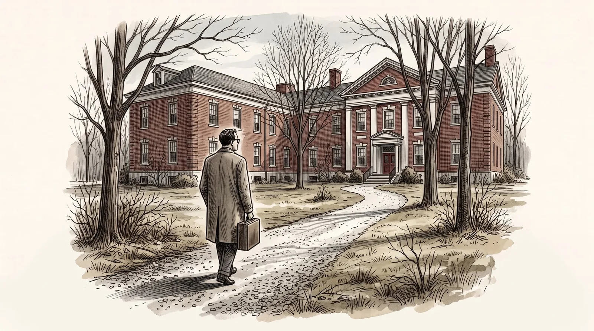

<figure class="ilustracao">

<figcaption>Manhã de primavera; o poeta, de costas, com uma mala pequena, sobe sozinho o caminho de cascalho até um hospital de tijolos. Ilustração gerada por IA (Google Gemini)</figcaption>

</figure>

No final de abril de 1959, quase um ano depois de sua última crise, Lowell se internou voluntariamente no McLean Hospital. As crises anteriores já tinham sido causado muito sofrimento e ele resolveu se internar para se tratar e evitar passar pelas situações embaraçosas que tinha vivido. Entretanto, em meados de junho, seu estado mental tinha piorado, estava agitado, excitado, com fuga de ideias, querelante, impulsivo. Sua internação foi então alterada para involuntária. Foram quase 3 meses de internação.
