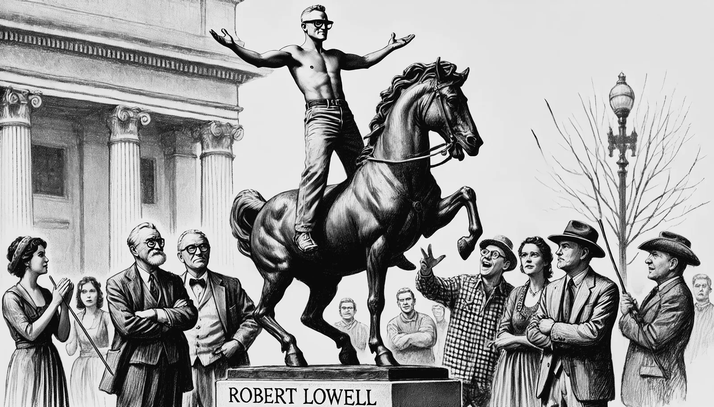

<figure class="ilustracao">

<figcaption>Image created by DALL·E - A scene depicting Robert Lowell, shirtless and wearing glasses, standing on top of equestrian statues as if pretending to ride them. Ilustração gerada por IA (DALL·E)</figcaption>

</figure>
Em agosto de 1962, numa viagem para a Argentina, Lowell entrou novamente num estado de mania. Começou a beber de forma exagerada, falar sem parar, e passou a não dormir. Interrompeu o uso de seus medicamentos, tornou-se desinibido, com sentimentos de grandiosidade, energizado e agitado. Insistia em comprar presentes caros para todos, mandou telegramas para o Papa e para o ex-presidente Eisenhower alegando que a América era o novo Império Romano. Passou acreditar que era o César da Argentina. Insultou publicamente o general que estava prestes a ser nomeado presidente na Argentina. Seu discurso aos poucos foi ficando fragmentado e desconexo. Nas praças da Argentina, Lowell se despiu a subiu em estátuas equinas para "cavalgar ao lado dos generais". Foram necessários seis homens para conter Lowell, que teve de ser contido com uma camisa de força e para ser levado para a Clínica de Bethlehem em Buenos Aires (<a class="cite" href="/robert-lowell/capitulos/referencias/#ref-Jamison2017" data-ref="Jamison2017" title="Jamison, Kay Redfield (2017). Robert Lowell: setting the river on fire, a study of genius, mania, and character">Jamison, 2017, p. 151</a>).
