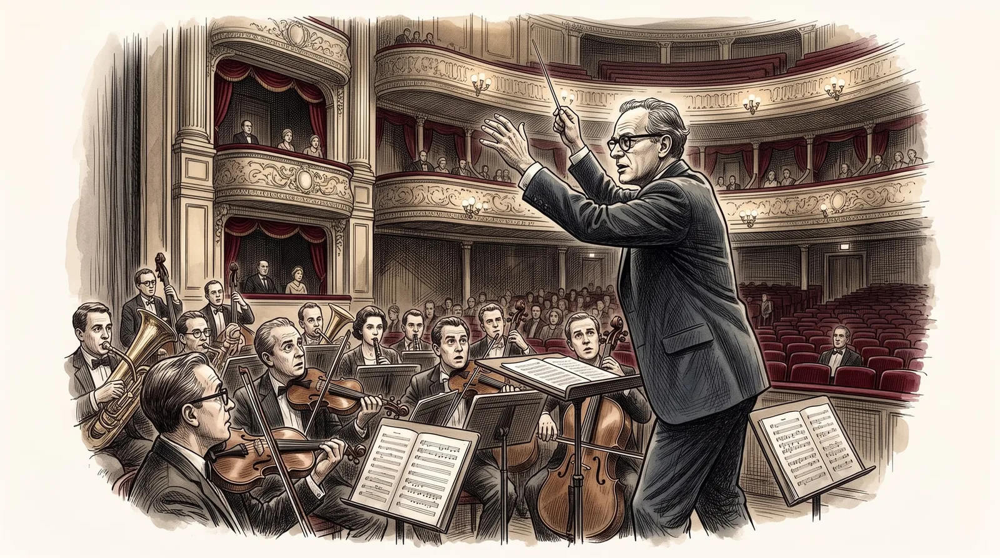

<figure class="ilustracao">

<figcaption>Interior de uma ópera; o poeta à beira do fosso da orquestra, braços erguidos como se regesse; músicos olham para cima, imóveis. Ilustração gerada por IA (Google Gemini)</figcaption>

</figure>

Os sintomas de mania de Lowell começaram a ficar novamente evidentes em setembro de 1966. Lowell começou a ter insônia, gastar dinheiro de forma exagerada, suas aulas na universidade, se tornaram caóticas. Apaixonou-se novamente por uma amiga. Passou a fazer comentários agressivos sobre seus amigos, e aos poucos se tornou delirante, passando a acreditar que era o Rei James IV, Napoleão, Hitler e até mesmo um messias judaico. Entrou no Metropolitan Opera e tentou conduzir a orquestra. Lowell mais uma vez precisou ser internado. Na véspera de Natal de 1966 cerca de 8 policiais foram à casa de Lowell para levá-lo para uma internação. Lowell arremessou uma garrafa de leite nos policiais, mas depois aceitou ser internado desde que os policiais aceitassem ouvi-lo recitar um poema. Seu amigo Grey Gowrie conseguiu convencer os policiais e todos ouviram Lowell recitar o poema "Waking in the Blue". Foi depois levado para o Hospital McLean onde foi internado de forma involuntária por quase três meses (<a class="cite" href="/robert-lowell/capitulos/referencias/#ref-Jamison2017" data-ref="Jamison2017" title="Jamison, Kay Redfield (2017). Robert Lowell: setting the river on fire, a study of genius, mania, and character">Jamison, 2017, pp. 154-155</a>).
